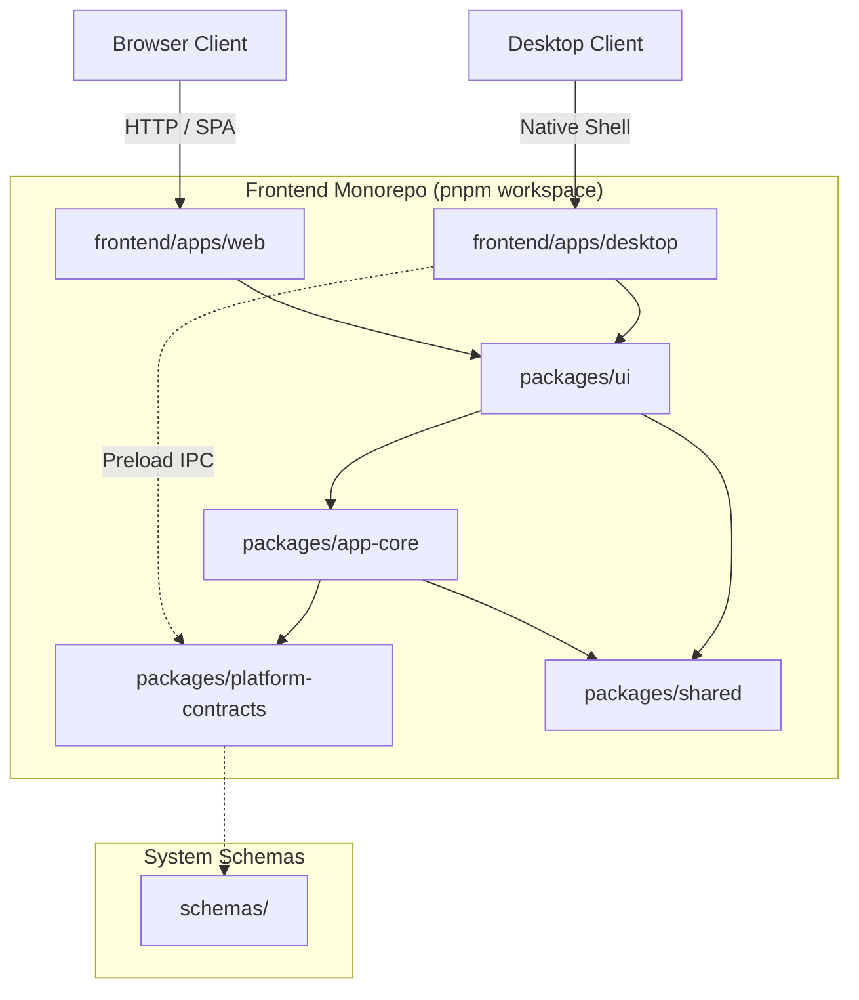

# VRMMotionGeneration — Web + Electron Desktop Foundation

A high-performance, type-safe monorepo foundation delivering a unified **Web application (SPA)** and **Native Desktop application (Electron)** sharing presentation components, reactive state stores, design tokens, and typed contracts.

> **Important Architectural Scope Notice**
> This repository underwent a complete architectural reset on **2026-10-22** (via branch `chore/web-electron-foundation-reset`).
> All prior experimental lines for neural motion generation, ARDY, MotionStreamer, DiP, kinematic retargeting, model training scripts, PyTorch/CUDA dependencies, and avatar checkpoints have been **permanently purged** from the active scope.
> The sole focus of this repository is a production-grade, secure **Web and Electron Desktop platform**.

---

## Architecture Overview



---

## Workspace Layout

```text
VRMMotionGeneration/
├── .agents/                    # Agent harness (roles, rules, actionable skills, workflows)
├── .github/workflows/          # CI quality gates (lint, typecheck, test, build)
├── .gitignore                  # Environment, cache, and artifact exclusions
├── .npmrc                      # Strict pnpm workspace configuration
├── .node-version               # Pinned Node.js runtime (v22 / v24)
├── AGENTS.md                   # Operation Dev operating contract
├── README.md                   # Project overview and operational guide
├── CHANGELOG.md                # Version history and reset notes
├── LICENSE                     # MIT License
├── package.json                # Workspace scripts and root test harness
├── pnpm-workspace.yaml         # Monorepo package declarations
├── tsconfig.base.json          # Root TypeScript strict compiler settings
├── frontend/                   # Client presentation domain
│   ├── apps/
│   │   ├── web/                # Browser client (Vite SPA)
│   │   └── desktop/            # Native desktop client (Electron 34+)
│   └── packages/
│       ├── platform-contracts/ # Pure TypeScript interfaces (DesktopAPI, Diagnostics)
│       ├── shared/             # Application constants and helpers
│       ├── app-core/           # Platform detection, state stores, and fallbacks
│       └── ui/                 # Vue 3 components, views, and CSS design tokens
├── backend/                    # Server domain (Explicitly NOT IMPLEMENTED / OPTIONAL)
├── infra/                      # CI workflows and Windows packaging specifications
├── docs/                       # Lifecycle documentation (Discovery, Architecture, Security)
├── diagrams/                   # Derived visual Mermaid projections
└── schemas/                    # Versioned machine-readable JSON Schema contracts
```

---

## Technology Stack

- **Framework**: [Vue 3](https://vuejs.org/) (Composition API, `<script setup lang="ts">`)
- **Language**: [TypeScript 5.7+](https://www.typescriptlang.org/) (strict mode enforced across all packages)
- **Bundler & Dev Server**: [Vite 6+](https://vite.dev/)
- **Desktop Shell**: [Electron 34+](https://www.electronjs.org/) (Hardened security: Context Isolation, Sandboxed, nodeIntegration disabled)
- **Monorepo & Package Management**: [pnpm](https://pnpm.io/) workspaces
- **Testing**: [Vitest 3+](https://vitest.dev/) with JSDOM
- **Code Quality**: [Prettier](https://prettier.io/) + ESLint

---

## Prerequisites

- **Node.js**: `v20.x`, `v22.x`, or `v24.x` (Verified with `v24.18.0`)
- **pnpm**: `v10+` or `v12+` (Verified with `12.14.0`)
- **Git**: 2.30+

---

## Getting Started

```bash
# 1. Install all monorepo dependencies
pnpm install

# 2. Run the Web application in local development mode
pnpm dev:web

# 3. Run the Electron Desktop application in development mode
pnpm dev:desktop

# 4. Run TypeScript typecheck across all packages
pnpm typecheck

# 5. Run lint formatting check
pnpm lint

# 6. Run automated test suites (Vitest)
pnpm test

# 7. Build Web production distribution
pnpm build:web

# 8. Build Electron Desktop production distribution
pnpm build:desktop
```

---

## Electron Security Invariants

In compliance with the [Official Electron Security Checklist](https://www.electronjs.org/docs/latest/tutorial/security/):

1. **`contextIsolation = true`**: Preload scripts execute in a separate context from the web page.
2. **`nodeIntegration = false`**: Node.js APIs are completely inaccessible in the renderer.
3. **`sandbox = true`**: Renderer processes run inside an OS sandbox.
4. **`webSecurity = true`**: Standard same-origin policy is strictly enforced.
5. **Typed IPC Bridge**: Only strongly typed channels (`app:get-version`, `app:get-diagnostics`, `app:ping`) are exposed through `window.desktopAPI`.
6. **Navigation Guard**: External URLs are intercepted and opened exclusively via `shell.openExternal`.

For details, see [Electron Security Baseline](file:///c:/Users/PC/Project/VRMMotionGeneration/docs/04-security/electron-security-baseline.md).

---

## License

This project is licensed under the [MIT License](file:///c:/Users/PC/Project/VRMMotionGeneration/LICENSE).