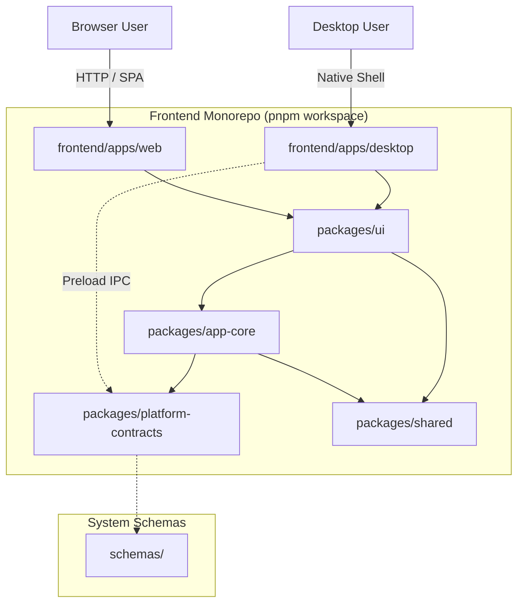
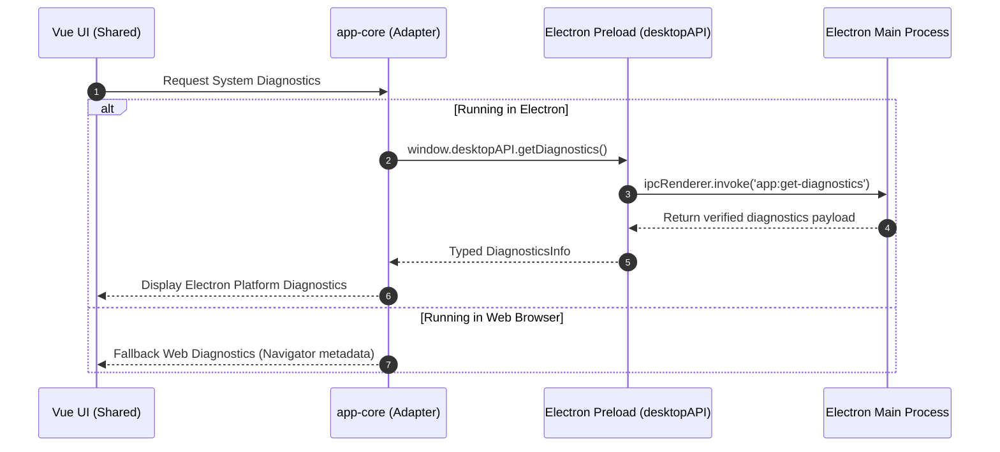

# Target Architecture — Web + Electron Desktop Monorepo

**Document**: Target Architecture Blueprint  
**Status**: APPROVED  
**Audience**: Engineering, QA, Security, DevOps  

---

## 1. System Context

The application foundation is organized into three primary top-level responsibility zones:

1. **`frontend/`**: The complete presentation and client application domain. Houses both the Web application (`apps/web`), the Electron Desktop application (`apps/desktop`), and shared reusable libraries (`packages/platform-contracts`, `packages/shared`, `packages/app-core`, `packages/ui`).
2. **`backend/`**: Server-side logic and persistence. Marked explicitly as `NOT IMPLEMENTED / OPTIONAL` for this initial foundation, avoiding unnecessary server bloat when the shell operates locally.
3. **`infra/`**: Continuous integration workflows, packaging recipes for Windows desktop, and operational maintenance scripts.

---

## 2. Package Topology & Boundaries

| Package / App | Path | Primary Role | Allowed Dependencies | Prohibited Dependencies |
| :--- | :--- | :--- | :--- | :--- |
| `@vrm/platform-contracts` | `frontend/packages/platform-contracts` | Type definitions for desktop IPC, diagnostics, and platform capabilities | None (Pure TS types) | Node.js, Electron, Vue |
| `@vrm/shared` | `frontend/packages/shared` | Shared constants, string helpers, formatting utils | `@vrm/platform-contracts` | Node.js, Electron, Vue |
| `@vrm/app-core` | `frontend/packages/app-core` | Platform detection, runtime adapters, reactive state stores | `@vrm/platform-contracts`, `@vrm/shared`, `vue` | Electron main APIs, `node:fs` |
| `@vrm/ui` | `frontend/packages/ui` | Vue 3 components, views, CSS design tokens, layouts | `@vrm/app-core`, `@vrm/shared`, `@vrm/platform-contracts`, `vue` | Electron, Node.js |
| `@vrm/web` | `frontend/apps/web` | Browser client entrypoint and Vite SPA config | `@vrm/ui`, `@vrm/app-core`, `@vrm/shared`, `vue` | Electron, Node.js |
| `@vrm/desktop` | `frontend/apps/desktop` | Electron native shell (main, preload, renderer) | `@vrm/ui`, `@vrm/app-core`, `@vrm/platform-contracts`, `electron` | Direct renderer access to `child_process` |

---

## 3. Web vs. Desktop Adaptability

