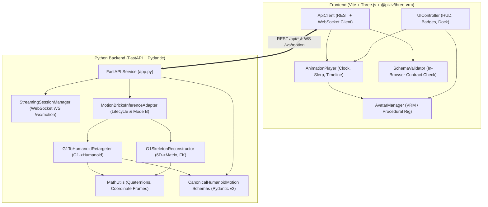

# 03 - System Architecture & Component Design

## 1. Architectural Principles

1. **Strict Separation of Concerns:**
   - **Generation:** MotionBricks neural inference models.
   - **Decoding & Reconstruction:** Converting continuous tensors to kinematic joint matrices.
   - **Retargeting:** Converting robot-specific serial chains into humanoid bone hierarchies.
   - **Contract Serialization:** Strict Pydantic models for `CanonicalHumanoidMotion/v1`.
   - **Rendering & Animation:** Browser runtime utilizing Three.js and `@pixiv/three-vrm`.
2. **Model Independence:**
   The VRM runtime accepts only `CanonicalHumanoidMotion/v1` data. It has zero dependencies on PyTorch, CUDA, or MotionBricks tensor structures.
3. **Dual Operating Modes:**
   Explicit separation between Mode A (Zero-GPU Offline Fixture) and Mode B (Genuine Checkpoint Inference).

---

## 2. Component Architecture

---

## 3. Module Breakdown

### 3.1 Backend Modules (`backend/src/motionbricks_vrm`)
- **`schemas/canonical_motion.py`:** Formal specification of `CanonicalHumanoidMotion/v1` using Pydantic v2, enforcing quaternion normalization, timestamp monotonicity, and valid humanoid bone identities.
- **`reconstruction/math_utils.py`:** Pure-Python/NumPy geometry functions for 6D-to-matrix, matrix-to-quaternion Shepperd conversion, quaternion multiplication, and $R_Y(180^\circ)$ coordinate transformation.
- **`reconstruction/g1_skeleton.py`:** Source kinematic tree for Unitree G1 robot (`G1Skeleton34`), decomposing 414-dim feature vectors into world positions, 6D continuous rotations, and parent-relative local rotations.
- **`retargeting/retargeter.py`:** Maps G1 serial hinge joints (pitch $\rightarrow$ roll $\rightarrow$ yaw) into standard 3-DOF humanoid bones (upperLeg, spine, upperArm, hand).
- **`source_adapter/inference_adapter.py`:** Inspects upstream MotionBricks directory, identifies LFS pointers versus genuine weights, and manages genuine inference lifecycle.
- **`streaming/session.py`:** WebSocket manager for chunked/frame-by-frame motion streaming.
- **`app.py`:** FastAPI service exposing REST and WebSocket endpoints.

### 3.2 Frontend Modules (`frontend/src`)
- **`avatar/vrm_manager.js`:** Three.js scene, lighting, camera controls, GLTFLoader with `VRMLoaderPlugin`, and fallback procedural humanoid rig.
- **`animation/player.js`:** Decoupled timeline player with slerp quaternion interpolation.
- **`motion/schema_validator.js`:** In-browser schema and integrity validation.
- **`transport/api_client.js`:** HTTP and WebSocket transport client with fallback to local static fixtures.
- **`ui/components.js`:** Dark modern UI, HUD stat updates, and toast notifications.
