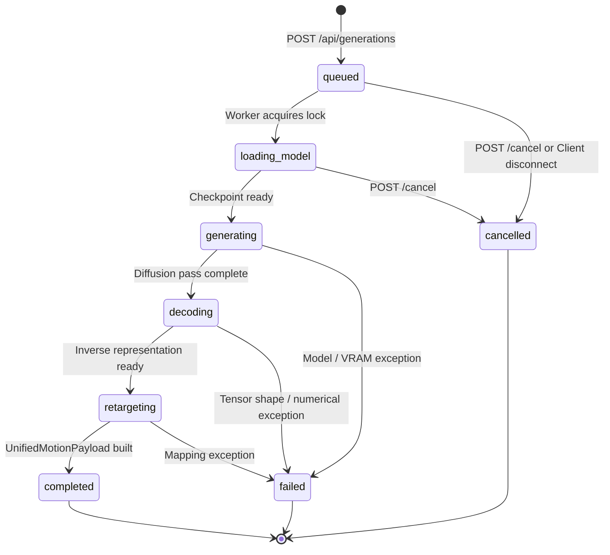

# API Job Lifecycle and State Machine Specification

## 1. Job Lifecycle State Machine

---

## 2. Status Contract & Schema Definitions

| Status | Trigger / Event | UI Telemetry Indicator | Actionable Behavior |
| :--- | :--- | :--- | :--- |
| `queued` | Generation job created in memory | `Job <id> queued` | Generate button disabled, Cancel button enabled |
| `loading_model` | Worker begins loading weights/safetensors | `Loading ARDY model...` | Progress bar updates to 10% |
| `generating` | Diffusion denoising step in progress | `Generating diffusion pass...` | Progress bar updates to 30%–70% |
| `decoding` | Inverse motion representation conversion | `Decoding motion...` | Progress bar updates to 85% |
| `retargeting` | VRM bone calibration & quaternion generation | `Retargeting to VRM...` | Progress bar updates to 95% |
| `completed` | Generation and retargeting succeeded | `Complete` | Motion applied to rigs, UI re-enabled |
| `failed` | Runtime exception in backend worker | `Failed` | Toast notification with safe diagnostic, UI re-enabled |
| `cancelled` | Job cancelled by user or aborted | `Cancelled` | Toast notification, UI re-enabled |

---

## 3. Streaming and Polling Fallback Architecture

1. **Primary Streaming Channel:** WebSocket at `/api/generations/{job_id}/events`.
   * On connection, sends the current snapshot of `JobStatusResponse`.
   * Pushes granular lifecycle events as they occur.
   * Closes cleanly upon reaching terminal status (`completed`, `failed`, or `cancelled`).
2. **Reliable Polling Fallback:**
   * If the WebSocket connection fails, encounters network transport errors, or is blocked by an HTTP proxy, the frontend transitions to `pollJobStatus()`.
   * Polls `GET /api/generations/{job_id}` every 500ms.
   * Guaranteed interval cleanup prevents zombie timer leaks upon terminal status or UI unmount.
3. **Concurrency Control:**
   * Backend enforces maximum 1 concurrent GPU generation job via `asyncio.Lock` and `active_job_count`.
   * Returns HTTP `429 Too Many Requests` if a job is already in progress.
   * `finally` blocks guarantee `active_job_count` decrements on all exception and cancellation paths.
