# CoreSkeleton27 to VRM Humanoid Retargeting

## 1. Hierarchy Mapping and Structural Discrepancies

NVIDIA ARDY CoreSkeleton27 uses a 27-joint hierarchy optimized for physics and humanoid simulation. The standard glTF / VRM 1.0 Humanoid rig defines 22 standard bones with differing intermediate joints.

```mermaid
graph TD
    subgraph ARDY CoreSkeleton27
        CHips["0: Hips"] --> CSpine["1: Spine"]
        CSpine --> CSpine1["2: Spine1"]
        CSpine1 --> CSpine2["3: Spine2 (Extra)"]
        CSpine2 --> CSpine3["4: Spine3"]
        CSpine3 --> CNeck["5: Neck"] --> CHead["6: Head"]
        CSpine3 --> CRShoulder["7: RightShoulder"] --> CRArm["8: RightArm"] --> CRFArm["9: RightForeArm"] --> CRHand["10: RightHand"]
        CSpine3 --> CLShoulder["13: LeftShoulder"] --> CLArm["14: LeftArm"] --> CLFArm["15: LeftForeArm"] --> CLHand["16: LeftHand"]
        CHips --> CRUpLeg["19: RightUpLeg"] --> CRLeg["20: RightLeg"] --> CRFoot["21: RightFoot"] --> CRToe["22: RightToeBase"]
        CHips --> CLUpLeg["23: LeftUpLeg"] --> CLLeg["24: LeftLeg"] --> CLFoot["25: LeftFoot"] --> CLToe["26: LeftToeBase"]
    end

    subgraph VRM Humanoid Rig
        VHips["hips"] --> VSpine["spine"]
        VSpine --> VChest["chest"]
        VChest --> VUpperChest["upperChest"]
        VUpperChest --> VNeck["neck"] --> VHead["head"]
        VUpperChest --> VRShoulder["rightShoulder"] --> VRArm["rightUpperArm"] --> VRFArm["rightLowerArm"] --> VRHand["rightHand"]
        VUpperChest --> VLShoulder["leftShoulder"] --> VLArm["leftUpperArm"] --> VLFArm["leftLowerArm"] --> VLHand["leftHand"]
        VHips --> VRUpLeg["rightUpperLeg"] --> VRLeg["rightLowerLeg"] --> VRFoot["rightFoot"] --> VRToes["rightToes"]
        VHips --> VLUpLeg["leftUpperLeg"] --> VLLeg["leftLowerLeg"] --> VLFoot["leftFoot"] --> VLToes["leftToes"]
    end
```

### Mapping Table

| VRM Bone Name | Target VRM Parent | Source Core Joint | Core Joint Index | Core Source Parent | Policy / Handling |
| :--- | :--- | :--- | :--- | :--- | :--- |
| `hips` | *None* | `Hips` | 0 | *None* | Global root orientation & translation |
| `spine` | `hips` | `Spine` | 1 | `Hips` (0) | Relative rotation to `hips` |
| `chest` | `spine` | `Spine1` | 2 | `Spine` (1) | Relative rotation to `spine` |
| `upperChest` | `chest` | `Spine3` | 4 | `Spine2` (3) | Absorbs intermediate `Spine2` twist |
| `neck` | `upperChest` | `Neck` | 5 | `Spine3` (4) | Relative rotation to `upperChest` |
| `head` | `neck` | `Head` | 6 | `Neck` (5) | Relative rotation to `neck` |
| `rightShoulder`| `upperChest` | `RightShoulder` | 7 | `Spine3` (4) | Relative rotation to `upperChest` |
| `rightUpperArm`| `rightShoulder`| `RightArm` | 8 | `RightShoulder` (7)| Limb rotation relative to shoulder |
| `rightLowerArm`| `rightUpperArm` | `RightForeArm` | 9 | `RightArm` (8) | Elbow flex/twist relative to upper arm |
| `rightHand` | `rightLowerArm` | `RightHand` | 10 | `RightForeArm` (9) | Wrist orientation relative to lower arm |
| `leftShoulder` | `upperChest` | `LeftShoulder` | 13 | `Spine3` (4) | Relative rotation to `upperChest` |
| `leftUpperArm` | `leftShoulder` | `LeftArm` | 14 | `LeftShoulder` (13)| Limb rotation relative to shoulder |
| `leftLowerArm` | `leftUpperArm` | `LeftForeArm` | 15 | `LeftArm` (14) | Elbow flex/twist relative to upper arm |
| `leftHand` | `leftLowerArm` | `LeftHand` | 16 | `LeftForeArm` (15)| Wrist orientation relative to lower arm |
| `rightUpperLeg`| `hips` | `RightUpLeg` | 19 | `Hips` (0) | Hip pitch/yaw/roll |
| `rightLowerLeg`| `rightUpperLeg` | `RightLeg` | 20 | `RightUpLeg` (19) | Knee flexion |
| `rightFoot` | `rightLowerLeg` | `RightFoot` | 21 | `RightLeg` (20) | Ankle flexion/tilt |
| `rightToes` | `rightFoot` | `RightToeBase` | 22 | `RightFoot` (21) | Toe bend |
| `leftUpperLeg` | `hips` | `LeftUpLeg` | 23 | `Hips` (0) | Hip pitch/yaw/roll |
| `leftLowerLeg` | `leftUpperLeg` | `LeftLeg` | 24 | `LeftUpLeg` (23) | Knee flexion |
| `leftFoot` | `leftLowerLeg` | `LeftFoot` | 25 | `LeftLeg` (24) | Ankle flexion/tilt |
| `leftToes` | `leftFoot` | `LeftToeBase` | 26 | `LeftFoot` (25) | Toe bend |

*Note: Joints 11, 12, 17, 18 (`RightHandEnd`, `RightHandThumb1`, `LeftHandEnd`, `LeftHandThumb1`) and Joint 3 (`Spine2`) are retained in the canonical 3D skeleton visualization and absorbed into parent orientation calibration.*

---

## 2. Mathematical Retargeting Algorithm

### The Defect in Direct Local Matrix Transfer
The previous implementation directly copied `local_rot_mats[:, j]` to `vrm_bones[bone]`. Because CoreSkeleton27 contains `Spine2` (joint 3) while VRM connects `chest` directly to `upperChest`, dropping `Spine2` corrupted the orientation of all upper body bones. Furthermore, VRM normalized bones expect rotations in normalized T-pose parent space.

### The Calibrated Solution
1. **Compute Desired Global Orientations:**
   Run forward kinematics over CoreSkeleton27 to obtain global rotation matrices for all joints:
   $$R_{global, 0} = R_{local, 0}$$
   $$R_{global, j} = R_{global, P(j)} \cdot R_{local, j}$$

2. **Compute Target VRM Local Rotations:**
   For each bone $B$ mapped to CoreSkeleton joint $j(B)$ and target VRM parent $P_{VRM}(B)$:
   If $B$ is `hips`:
   $$R_{local, hips}^{VRM} = R_{global, j(hips)}$$
   For any child bone $B$:
   $$R_{local, B}^{VRM} = \left(R_{global, j(P_{VRM}(B))}\right)^{-1} \cdot R_{global, j(B)} = \left(R_{global, j(P_{VRM}(B))}\right)^T \cdot R_{global, j(B)}$$

3. **Forward Kinematics Invariant Verification:**
   When the VRM engine computes forward kinematics:
   $$R_{global, B}^{VRM} = R_{global, P_{VRM}(B)}^{VRM} \cdot R_{local, B}^{VRM} = R_{global, j(P_{VRM}(B))} \cdot \left(R_{global, j(P_{VRM}(B))}\right)^T \cdot R_{global, j(B)} \equiv R_{global, j(B)}$$
   The global 3D orientation of every bone in the VRM humanoid rig matches the source skeleton with **zero angular error**, regardless of skipped intermediate bones or torso bending.

4. **Continuous Unit Quaternions:**
   Local matrices are converted to unit quaternions $[x, y, z, w]$ with dot-product continuity checks ($\vec{q}_t \cdot \vec{q}_{t-1} \ge 0$) to eliminate $180^\circ$ slerp flips.
