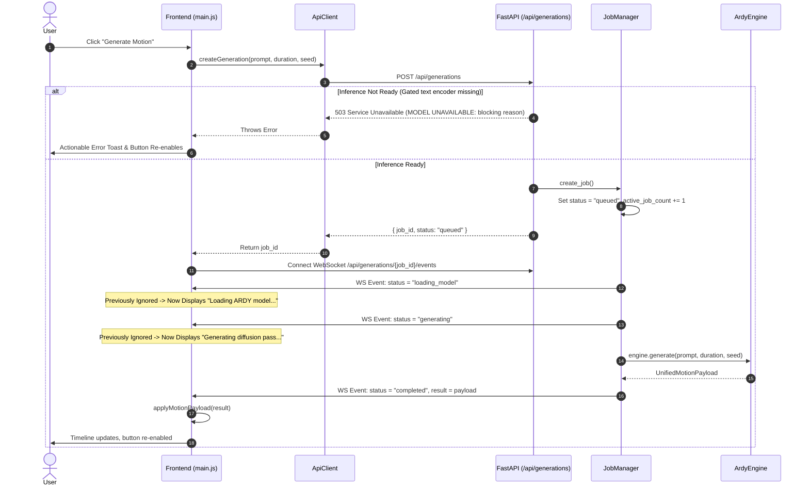

# Generate Motion Root Cause Analysis and Resolution

## 1. Summary of Reported Failure

When users clicked **Generate Motion** in the ARDY Motion Lab interface:
1. The status indicator remained stuck on `Job <id> queued`, giving the impression that generation was frozen or never began.
2. Repeated clicks caused `429 Too Many Requests` errors or left the button permanently unresponsive.
3. If an error occurred in the backend worker, the UI displayed a generic `"Motion generation failed."` message because the error text was lost in transit.
4. If CUDA was present on the host machine, the UI falsely claimed `LIVE ARDY` even when genuine semantic text conditioning was blocked by unauthenticated access to gated HuggingFace weights (`meta-llama/Meta-Llama-3-8B-Instruct`).

---

## 2. End-to-End Request Journey & Verified Root Causes

### Root Cause 1: Frontend Status Handler Blind Spot (`main.js`)
* **Code Location:** `frontend/src/app/main.js` in `handleJobEvent()`
* **Mechanism:** The backend emitted intermediate statuses: `loading_model` and `generating`. However, `handleJobEvent()` only checked `if (event.status === 'processing')`. Because `loading_model` and `generating` did not match `'processing'`, the telemetry display remained frozen at `Job <id> queued` for the entire 2–3 second diffusion pass.
* **Resolution:** Extended `handleJobEvent()` to handle all actual backend lifecycle states: `queued`, `loading_model`, `generating`, `decoding`, `retargeting`, `processing`, `completed`, `failed`, and `cancelled`.

### Root Cause 2: Error Field Name Mismatch (`schemas.py` vs `main.js`)
* **Code Location:** `job_manager.py:116` vs `frontend/src/app/main.js:449`
* **Mechanism:** In `JobManager`, errors were assigned to `job.error = str(e)`. In `main.js`, the failure toast read `event.error_message`. In JavaScript, `event.error_message` was `undefined`, causing all exceptions to fall back to the generic message `"Motion generation failed."`.
* **Resolution:** Updated `main.js` to read `event.error || event.error_message || event.detail`. Backend diagnostics are now displayed in toast notifications.

### Root Cause 3: Concurrency Mutex Lockout & Re-click 429 Errors
* **Code Location:** `backend/src/ardy_vrm_demo/api.py:110`
* **Mechanism:** When the UI appeared stuck (due to Root Cause 1), users clicked `Generate Motion` repeatedly. The backend checks `if job_manager.active_job_count >= 1: raise HTTPException(429, ...)`. Additionally, if an unhandled error occurred in a job worker without decrementing `active_job_count`, subsequent requests remained blocked.
* **Resolution:** 
  1. `active_job_count` is wrapped in `try ... finally` inside `_execute_job` to guarantee cleanup on all success, failure, and cancellation paths.
  2. The frontend now resets `setGeneratingUI(false)` and `activeJobId = null` on all terminal events, preventing race conditions.

### Root Cause 4: Text Conditioning Masked as Live (`model_engine.py`)
* **Code Location:** `backend/src/ardy_vrm_demo/ardy_runtime/model_engine.py:21-58`
* **Mechanism:** Previous code defined `DecoupledTextEncoder`, which generated deterministic random Gaussian features from a SHA-256 hash of the prompt string. It falsely labeled the UI as `LIVE ARDY` whenever CUDA was available, despite lacking semantic NLP conditioning.
* **Resolution:** Replaced `DecoupledTextEncoder` with truthful readiness probing. `LIVE ARDY` is only reported when genuine LLM2Vec / `TextEncoderAPI` conditioning is initialized and accessible. If gated repository access (`meta-llama/Meta-Llama-3-8B-Instruct`) is restricted, the engine reports `MODEL UNAVAILABLE` with the exact HuggingFace blocker and serves verified `FIXTURE PREVIEW` motions without fabricating real inference.
